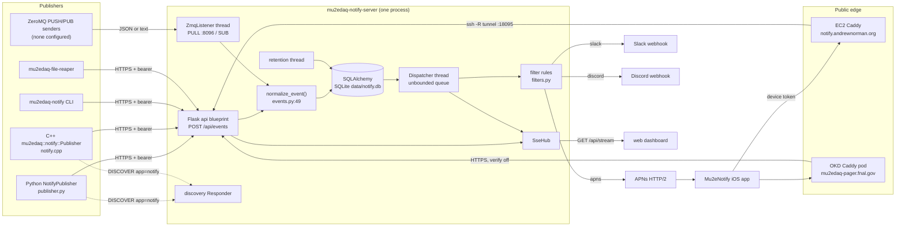

# mu2edaq-phone-notification-system

> Terminal alarm destination for the Mu2e DAQ: a Flask server on 8095 that ingests
> events over an HTTP JSON API or a ZeroMQ compatibility listener, routes them with
> database-held filter rules, and delivers them to iPhones (APNs), Slack, Discord and
> a live SSE web dashboard.

| | |
|---|---|
| Repository | `Mu2e/mu2edaq-phone-notification-system` (public, issues on) |
| Languages | Python 3.9+ (server, publisher, scripts), C++17 (publisher library), Swift/SwiftUI (iOS app), Jinja2 + htmx (web UI), Bash, Helm |
| Ports | 8095/tcp HTTP(S) API + web UI + SSE; 8096/tcp ZeroMQ PULL (only with `zmq.enabled`, default off); 28999/udp multicast discovery |
| Depends on | `mu2edaq-discovery` (optional import); external APNs, Slack, Discord, Route 53/EC2, OKD, Vault (deploy only) |
| Used by | `mu2edaq-file-reaper` (HTTP publisher, `notify` extra) |
| Doc dir | `docs/` (an empty `doc/` also exists; see PNS-010) |
| Interfaces | [INTERFACES.md](INTERFACES.md) · Operations: [OPERATIONS.md](OPERATIONS.md) · Findings: [ISSUES-PENDING.md](ISSUES-PENDING.md) |

## Purpose

DAQ applications report error and warning conditions here, and the server's
job is to get them in front of a person who may be off site. It is the last hop
of the alarm chain, so its failure mode is a missed page rather than lost
data. The whole path is deliberately fail-soft: the publishers never raise on a
delivery failure, the dispatcher swallows per-event exceptions
(`src/mu2edaq_notify/server/dispatch.py:64-73`), and the APNs sender falls back
to log-only when its key is unreadable (`destinations.py:40-51`). The
consequence is that a delivery failure surfaces only in the `deliveries` table
— one row per attempt with status `sent`, `logged`, `failed` or `suppressed` —
and nowhere a monitor would look by default; `/api/health` reports configured
state, not delivery state (PNS-013).

The one confirmed publisher in the superproject is `mu2edaq-file-reaper`, which
declares `notify = ["mu2edaq-notify"]` (`mu2edaq-file-reaper/pyproject.toml:28`)
and enables it at `mu2edaq-file-reaper/config/mu2e-file-reaper-dl-01.yaml:68`.

## Architecture

## Components

| Path | Role |
|---|---|
| `src/mu2edaq_notify/events.py` | Event schema and `normalize_event()`, shared by server and Python publisher |
| `src/mu2edaq_notify/publisher.py`, `cli.py` | Stdlib-only HTTP publisher with primary/fallback addresses; `mu2edaq-notify send|ping` |
| `src/mu2edaq_notify/server/config.py` | `DEFAULTS` (`config.py:16-100`) is the authoritative schema; CLI > `MU2EDAQ_NOTIFY_*` > YAML > defaults |
| `src/mu2edaq_notify/server/app.py` | Flask `api` and `web` blueprints, read-access rule, request-derived public URL |
| `src/mu2edaq_notify/server/auth.py` | Publisher tokens, device tokens, HS256 enrollment JWTs, optional OIDC (Fermilab SSO) |
| `src/mu2edaq_notify/server/storage.py` | Models `Event`, `Device`, `FilterRule`, `Destination`, `Delivery`; session per call; hand-rolled column migration (`_ADDED_COLUMNS`, `storage.py:161`) |
| `src/mu2edaq_notify/server/dispatch.py` | Queue + daemon thread, rate limiting, serial delivery |
| `src/mu2edaq_notify/server/destinations.py` | APNs (HTTP/2, ES256 provider token), Slack and Discord webhooks |
| `src/mu2edaq_notify/server/filters.py` | Severity floor + fnmatch on source/host/category + optional regex |
| `src/mu2edaq_notify/server/zmq_listener.py` | ZeroMQ compatibility ingest |
| `src/mu2edaq_notify/server/sse.py` | Per-client bounded-queue SSE fan-out |
| `src/cpp/`, `src/include/mu2edaq_notify/` | C++17 publisher (libcurl) with its own discovery client |
| `ios/Mu2eNotify/` | SwiftUI iPhone app: QR/autoconfig enrollment, APNs receipt, 5 s event poll |
| `web/templates/` | Jinja2 + Tailwind CDN + htmx; dashboard, filters, destinations, devices, About, API, Sitemap |
| `scripts/`, `config/aws/`, `helm/` | Public edge: EC2 Caddy + reverse SSH tunnel + Route 53 self-registration; OKD Caddy chart; Vault fetch for the chart's tunnel keytab |

## Threading model

One process. Flask's development server runs threaded (`server/cli.py:224-226`,
`threaded=True`, `use_reloader=False`); every request, and every open SSE
stream for its whole life, holds one worker thread. Long-lived daemon threads:

| Thread | Created | Started | Loop |
|---|---|---|---|
| `notify-dispatcher` | `dispatch.py:27-28` | `cli.py:197` | blocks on `queue.Queue.get()`; delivers inline |
| `notify-zmq` | `zmq_listener.py:32-33` | `cli.py:207`, only with `zmq.enabled` | `zmq.Poller`, 500 ms |
| `notify-retention` | `cli.py:181-182` | same | `prune_events()`, then `sleep(3600)` |
| `mu2edaq-discovery-responder` | `mu2edaq_discovery.Responder` | `cli.py:156` | answers DISCOVER for `app=notify` |

Shared state and how it is protected:

* `Storage` opens a new `Session` per public method (`storage.py:198`); the
  engine is created with `check_same_thread=False` for SQLite
  (`storage.py:189-192`). No session crosses a thread. SQLite serializes
  writers; with Postgres (`database.url`) nothing changes in code.
* `Dispatcher` locks only its rate-limit table (`dispatch.py:26,53-61`). The
  work queue is unbounded (`dispatch.py:24`).
* `SseHub` locks its client set and publishes with `put_nowait`, dropping on a
  full per-client queue (`sse.py:25-33`), so a stalled browser cannot block
  ingest.
* `ApnsSender` locks only JWT minting (`destinations.py:53-63`); the
  `httpx.Client` is shared.

## Delivery path

`Dispatcher._dispatch` (`dispatch.py:75-100`) loads all filter rules and all
destinations from the database for every event, computes the matched
destination names, applies the rate limit on `(source, severity, title)` with
a 60 s default window (`dispatch.py:47-62`, `config.py:88`), then delivers to
each destination in sequence. An APNs destination is a serial loop over every
enabled device whose own `min_severity` admits the event
(`dispatch.py:102-111`, `storage.py:311-319`). Each HTTP call has a 10 s
timeout and is attempted once (`destinations.py:45,108`). A slow channel
therefore delays the channels after it and every queued event behind it;
a transient failure is recorded as `failed` and never retried (PNS-002,
PNS-003).

Rate-limited events still get `suppressed` delivery rows, so suppression is
auditable. The comment at `config/notify-server.yaml:103` describes the key as
`(rule, source, title)`; the code uses `(source, severity, title)` (#8 covers
the key's scope).

## Interfaces

Full detail in [INTERFACES.md](INTERFACES.md). Summary:

* `POST /api/events` with a bearer token is the call other packages make.
  Delivery is asynchronous; `201` means stored, not paged.
* `GET /api/events`, `/api/events/<id>`, `/api/stream` are readable without
  any credential whenever OIDC is off (#1).
* The ZeroMQ PULL listener on 8096 is transport-compatible with the
  `mu2edaq-dashboard` bus and schema-incompatible with it: every dashboard
  message is ingested as `warning` from source `zmq` with no category
  (PNS-001, S3, bounded by `zmq.enabled: false`).
* Python and C++ publisher libraries with identical primary/fallback
  semantics; both resolve their address by discovery once and never again.

## Configuration

`config/notify-server.yaml`; schema and defaults in
`src/mu2edaq_notify/server/config.py:16-100`; environment map at
`config.py:104-126`. Precedence: command line > `MU2EDAQ_NOTIFY_*` > YAML >
defaults (`config.py:151-191`). Behaviours worth knowing:

* A nonexistent `--config` path is ignored without a message
  (`config.py:160-161`), and so is a nonexistent `auth.api_tokens_file`
  (`config.py:174-180`). The result in both cases is a server with no
  publisher tokens and an open publish API, announced only by one WARNING.
* A scalar environment value for a list-valued key appends; a YAML list
  replaces; a command-line list (`--api-token`, `--trusted-host`) replaces
  (`config.py:139-148`).
* `server.secret_key` and `auth.enrollment_secret` are generated per process
  when empty (`config.py:182-189`) and not persisted, contrary to the comment
  at `config/notify-server.yaml:33` (PNS-005).
* Relative paths (`database.url`, `apns.key_file`, `auth.api_tokens_file`,
  TLS files) resolve against the working directory, not the config file (#4).

The shipped `config/notify-server.yaml` is the production host's working
configuration, not a template: TLS on with Let's Encrypt paths for
`kaon.andrewnorman.org`, APNs on with a specific `key_id`/`team_id` and
`sandbox: true`, OIDC off, `base_url`/`fallback_url`
`https://mu2edaq-pager.fnal.gov` (PNS-004).

## Operations

See [OPERATIONS.md](OPERATIONS.md). Deployment as found on 2026-10-06: the
server runs on a macOS workstation under a per-user launchd agent
(`org.mu2edaq.notify-server`, `RunAtLoad` + `KeepAlive`) that executes
`venv/bin/mu2edaq-notify-server --config config/notify-server.yaml` with its
`WorkingDirectory` set to this repository's checkout inside the `mu2edaq-main`
superproject. The production pager therefore runs whatever branch is checked
out there (on 2026-10-06, `mu2e-sept-mega-review`) at its next restart. The
plist is not in the repository (PNS-007).
Public access is through two Caddy proxies that forward every path: an EC2
instance reached over a reverse SSH tunnel, and an OKD pod that connects to the
server's HTTPS listener directly with certificate verification disabled
(PNS-014). Because every path is forwarded and the configuration the agent
runs has OIDC off, the web UI's mutating routes are reachable without
authentication from the public side: with the shipped configuration an
anonymous `POST /destinations/<id>/delete` removes the only destination and
silences every page (#1, assessed S1 in PNS-023; reproduced with the Flask
test client, the live endpoint was not probed).

## Interactions with other packages

| Package | Direction | Mechanism | Evidence |
|---|---|---|---|
| `mu2edaq-discovery` | out, optional | imports `Responder` to announce `app=notify` | `src/mu2edaq_notify/server/cli.py:143`; publisher side `src/mu2edaq_notify/publisher.py:75` |
| `mu2edaq-file-reaper` | in | HTTP `POST /api/events` through this package's Python library | `mu2edaq-file-reaper/pyproject.toml:28`, `mu2edaq-file-reaper/config/mu2e-file-reaper-dl-01.yaml:68` (recorded in that package's manifest) |
| `mu2edaq-dashboard` | none today | its PUSH senders could target 8096; schema mismatch drops level, subsystem and category | `mu2edaq-dashboard/sender.py:90-97`, `src/mu2edaq_notify/events.py:64-77` |
| `mu2edaq-downtime-logger` | none today | its ZMQ run-state format is plain text on PUB; this listener's SUB mode could consume it as `warning` events | `mu2edaq-downtime-logger/tools/zmq_publish.py:27-41` |
| `mu2edaq-config` | holds copies | three drifted copies of `notify-server.yaml` (`base_url` `https://notify.andrewnorman.org`, no `dynamic_base_url`) and the APNs key; nothing in this package reads them | `mu2edaq-config/config-main/mu2edaq-phone-notification-system/notify-server.yaml:11` (PNS-028) |

## Review findings

Staged in [ISSUES-PENDING.md](ISSUES-PENDING.md) with fingerprints; 13 new
issues (12 individual, one S4 rollup) and four comments on existing issues.

| ID | Sev | Title |
|---|---|---|
| PNS-023 | S1 | comment on #1: the public web admin is unauthenticated in the configuration production runs |
| PNS-014 | S2 | OKD proxy disables certificate verification on its hop to the backend |
| PNS-001 | S3 | Dashboard-schema events lose severity, source and category in the ZeroMQ listener |
| PNS-002 | S3 | A transient delivery failure is never retried |
| PNS-003 | S3 | A slow or dead channel delays every later channel and every queued event |
| PNS-004 | S3 | `notify-server.yaml` ships one site's TLS paths and APNs identity |
| PNS-007 | S3 | Production supervision is an untracked per-user LaunchAgent |
| PNS-008 | S3 | No CI for a 185-test suite |
| PNS-011 | S3 | CMake install tree: stale man paths, no package Config file |
| PNS-013 | S3 | `/api/health` reports configured, not effective, APNs and ZeroMQ state |
| PNS-015 | S3 | Publishers send their token wherever an unauthenticated ANNOUNCE points |
| PNS-016 | S3 | Server discovery runs once per publisher and is never retried |
| PNS-017 | S3 | Database password and enrollment tokens are written to the server log |
| PNS-RU | S4 | Rollup: PNS-005, 010, 012, 019–022, 024–028 and the Windows bootstrap gap |
| PNS-009 | — | comment on #15 (APNs test isolation) |
| PNS-006 | — | comment on #3 (token comparison timing) |
| PNS-018 | — | comment on #4 (missing `--config` silently ignored) |

Existing open issues #1–#15 already cover web/admin and read authentication
(#1, re-assessed as S1 by PNS-023), fail-open publish auth (#3), relative paths (#4), permanent APNs failures
(#5), rate-limit key scope (#8), the `limit` parameter (#10), `meta` size (#12)
and the APNs test (#15).
